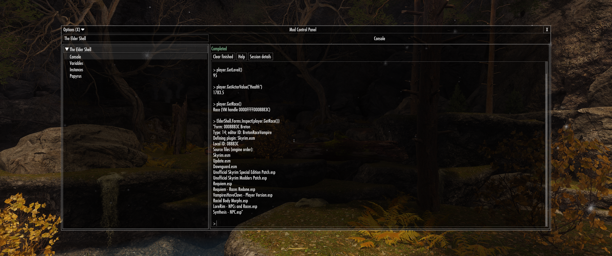
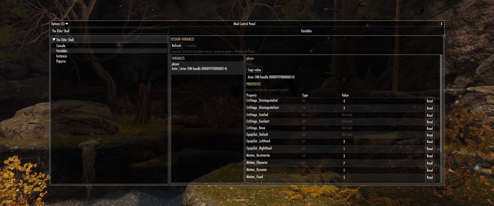
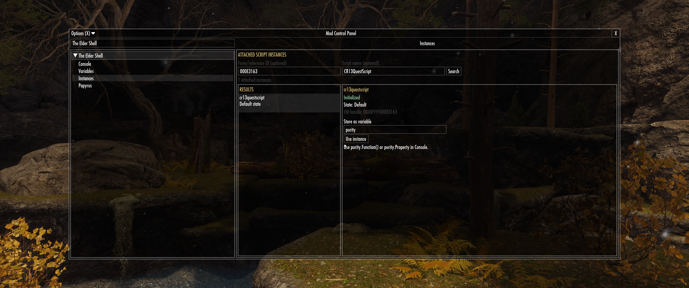
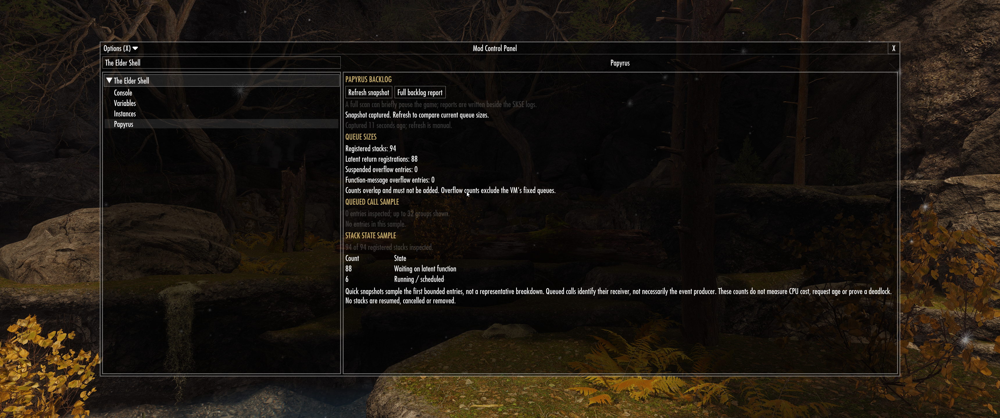

# The Elder Shell

**Ask the game what it's doing. Preferably before telling it to reset everything.**

The Elder Shell brings a Papyrus shell into Skyrim. Call installed script APIs,
inspect live objects, follow references through a mod's state, and test changes
while the game is running. For mod authors, patch makers and anyone whose
troubleshooting has progressed beyond glaring at an NPC.

Checking one property should not require a throwaway quest, a compiled test
script and another trip through the main menu.



## Get answers from the running game

- **Test a mod API where it actually runs.** Call functions on existing script
  instances, read properties, keep results in variables and inspect arrays.
- **Find the object a mod is really tracking.** Search attached scripts and follow
  their references instead of assuming that the NPC in front of you is the one
  in the controller.
- **Investigate quests before repairing them.** Inspect lifecycle, aliases,
  conditions and paused stacks; compare snapshots and preview supported repairs.
- **Explain dialogue and AI problems.** Check activation blocking, dialogue
  permissions, scenes, current packages and package interruption flags.
- **Identify forms and inspect plugin-related actor data.** See defining plugins
  and source files, then inspect supported factions, spells, effects, equipment,
  inventory, aliases and script bindings. Explicit cleanup functions are available.
- **See the Papyrus backlog.** Inspect queue sizes and grouped calls, refresh to
  see changes, and export full overflow reports. "My CPU is idle" has finally
  exhausted its usefulness as a diagnosis.

## Console:

Open **SKSE Menu Framework → The Elder Shell → Console** and try:

```papyrus
var player = Game.GetPlayer()
player.GetLevel()
player.GetActorValue("Health")
player.GetRace()
```

Use ordinary Papyrus statements, typed variables, arrays, properties and
`If`/`While` blocks. Member completion and parameter hints help explore installed
APIs. Commands and results share a selectable transcript; variables remain
available until you load a save or start a new game.

**Enter** submits complete input and continues unfinished blocks. **Tab** accepts
suggestions, **Escape** dismisses them, and **Up/Down** recalls history when the
suggestion list is closed. Paste several statements or use **Shift+Enter** for
another line; a trailing `\` joins lines.

## Variables:

Browse session variables, inspect array elements and read object properties.
Property getters run only when you explicitly click **Read**.



## Instances:

Search by form/reference ID, script name or both. Select an attached instance,
give it a variable name and click **Use instance**. Its functions and properties
are then available in Console through `instance.Function()` and
`instance.Property`.



## Papyrus:

**Refresh snapshot** shows registered stacks, latent return registrations,
overflow queue sizes and grouped samples. **Full backlog report** exports a
larger scan beside the SKSE logs.

Counts describe queued work and stack state; they do not measure CPU cost,
request age or prove a deadlock. Refreshing lets you see whether the backlog is
growing or draining.



## Built-in services

`ElderShell` provides `Selection`, `Forms`, `Actors`, `AI`, `Quests`, `Scripts`
and `Console` services alongside ordinary Papyrus.

Select an NPC in Skyrim's console, then inspect it:

```papyrus
var npc = ElderShell.Selection.GetConsoleActor()
ElderShell.Forms.Inspect(npc)
ElderShell.Actors.InspectDialogue(npc)
```

Check that `npc` contains an actor before calling its methods. You can also
capture immediate Skyrim console output:

```papyrus
var output = ElderShell.Console.Execute("player.getavinfo health")
output
```

See the [usage guide](docs/usage.md) for syntax, service functions, controls and
limits, and [quest diagnostics](docs/quest-diagnostics.md) for inspection,
snapshot comparisons and checked recovery operations.

## Requirements and installation

| Requirement | What to install |
| --- | --- |
| [SKSE](https://skse.silverlock.org/) | The build matching your Skyrim executable. Launch through SKSE. |
| [Address Library for SKSE Plugins](https://www.nexusmods.com/skyrimspecialedition/mods/32444) | The package covering your executable version. |
| [SKSE Menu Framework](https://www.nexusmods.com/skyrimspecialedition/mods/120352) **3.9+** | The runtime mod. |

Install the complete release ZIP through your mod manager and enable
**TheElderShell.esp**. Keep the DLL and service scripts together. The Papyrus
compiler is embedded; no separate compiler installation is needed in-game.

Tested on Skyrim **1.6.1170**. Other runtimes are unverified; quest startup
failure recovery is restricted to 1.6.1170. Match dependencies to your executable
version rather than the Special Edition / Anniversary Edition store label.

## Before you start fixing things

This tool executes real Papyrus against your running game. Calls and property
getters can change state, and those changes can persist in your save. Keep a
separate save before recovery or cleanup. Skyrim does not offer an undo button
because you typed the command confidently.

Plugin cleanup removes supported actor data; it is not a complete mod uninstaller.
Console output captures immediate results and does not wait for deferred work.
For installed script APIs, supply all arguments, including optional ones; packaged
Elder Shell services expose their defaults.

## Development

Build with Visual Studio 2022 C++ tools, Windows SDK, CMake, Ninja and .NET 10:

```powershell
./setup.ps1
./build.ps1
```

The installable files are written to `build/package`. For UI work,
`./tools/ui-preview/build.ps1` opens a standalone preview with hot reload.

[Builds and releases](docs/build-release.md) ·
[UI preview](tools/ui-preview/README.md) ·
[Architecture](docs/architecture.md) ·
[Evaluation](docs/compiled-evaluation.md) ·
[Embedded compiler](docs/embedded-compiler.md) ·
[VM integration](docs/vm-integration.md)

## License

[GPL-3.0](LICENSE). Binary distributions require corresponding source and
dependency notices, including Caprica's MIT license.
